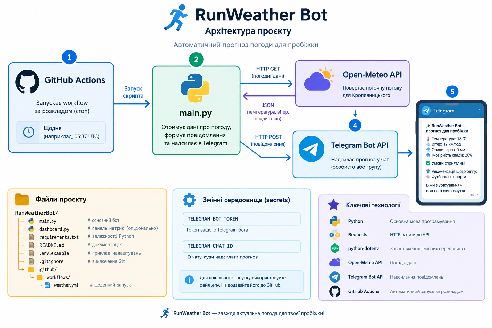

# 🏃 RunWeather Bot

**RunWeather Bot** — Telegram-бот на Python, який отримує актуальні погодні дані для Кропивницького та надсилає рекомендації щодо умов для пробіжки.

## 🌦️ Можливості

- 🌡️ Отримання поточної температури повітря.
- 💨 Відображення швидкості вітру.
- 🌧️ Інформація про поточні опади.
- ☔ Відображення ймовірності опадів.
- 👕 Рекомендації щодо спортивного одягу.
- 🏃 Оцінювання погодних умов для пробіжки.
- 📅 Автоматичне надсилання прогнозу щодня за допомогою GitHub Actions.

## 🛠️ Використані технології

- **Python** — основна мова програмування.
- **Requests** — HTTP-запити до API.
- **python-dotenv** — завантаження змінних середовища.
- **Open-Meteo API** — джерело погодних даних.
- **Telegram Bot API** — надсилання повідомлень.
- **GitHub Actions** — автоматичний запуск за розкладом.

## 📁 Структура проєкту





> Файл `.env` містить локальні секрети й не повинен потрапляти до GitHub. Змінні середовища на GitHub налаштовуються через Repository Secrets.

## ⚙️ Налаштування

### 1. Встановлення Python

Встановіть Python 3.11 або новішу сумісну версію.

### 2. Встановлення залежностей

Виконайте команду:

```bash
pip install -r requirements.txt
```

Файл `requirements.txt`:

```text
requests
python-dotenv
```

### 3. Створення Telegram-бота

1. Відкрийте Telegram і знайдіть `@BotFather`.
2. Створіть бота за допомогою команди `/newbot`.
3. Збережіть отриманий токен у безпечному місці.
4. Дізнайтеся свій `TELEGRAM_CHAT_ID`.

### 4. Налаштування змінних середовища

Для локального запуску створіть файл `.env`:

```env
TELEGRAM_BOT_TOKEN=your_telegram_bot_token
TELEGRAM_CHAT_ID=your_chat_id
```

Замініть значення на власні. Не публікуйте токен у відкритому репозиторії.

## 🚀 Запуск

Для ручного запуску виконайте:

```bash
python main.py
```

Якщо налаштування правильні, бот отримає погодні дані й надішле прогноз у Telegram.

## ⏰ Автоматичне надсилання

Для автоматичного запуску використовується GitHub Actions.

Файл workflow:

```text
.github/workflows/weather.yml
```

У репозиторії GitHub відкрийте:

**Settings → Secrets and variables → Actions**

Додайте такі Repository Secrets:

- `TELEGRAM_BOT_TOKEN`
- `TELEGRAM_CHAT_ID`

Workflow запускає `main.py` за розкладом і може запускатися вручну через вкладку **Actions**.

Час запуску задається в параметрі `cron` файлу `weather.yml`. GitHub Actions використовує час UTC, тому враховуйте сезонну зміну київського часу. Запланований запуск може відбуватися із затримкою.

## 🌍 Джерело погодних даних

Погодні дані отримуються з [Open-Meteo](https://open-meteo.com/).

Місто: **Кропивницький, Україна**.

## 🔐 Безпека

- Не зберігайте справжній Telegram-токен у вихідному коді.
- Не додавайте `.env` до Git.
- Зберігайте секрети в GitHub Actions Secrets.
- Не публікуйте особистий `TELEGRAM_CHAT_ID`, якщо він не потрібен для документації.

## 📌 Подальший розвиток

- Додавання прогнозу на кілька днів.
- Налаштування часу надсилання.
- Відображення додаткових погодних показників.
- Розширення рекомендацій для занять спортом.

---

**RunWeather Bot** — погода для планування пробіжки 🏃
